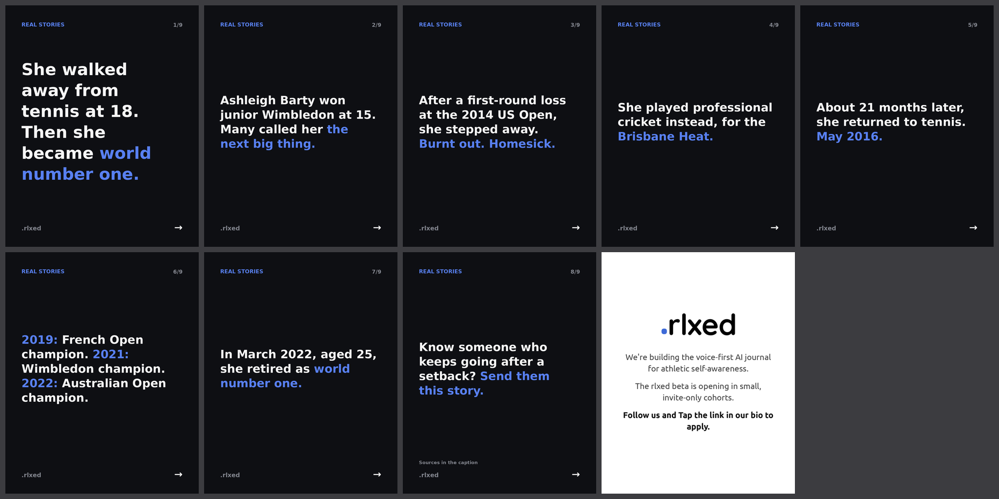

## ✅ Draft ready: Ashleigh Barty

**Story id:** `barty-break`  |  **Slides:** 9  |  **Closing brand slide:** light  |  **Nothing has been posted yet.**



<details><summary>Open the slides one by one</summary>

[Slide 1](https://raw.githubusercontent.com/arvind-eshwarlal/rlxed.posts/main/content/drafts/2026-11-22-barty-break-run1/slide_1.jpg)  
[Slide 2](https://raw.githubusercontent.com/arvind-eshwarlal/rlxed.posts/main/content/drafts/2026-11-22-barty-break-run1/slide_2.jpg)  
[Slide 3](https://raw.githubusercontent.com/arvind-eshwarlal/rlxed.posts/main/content/drafts/2026-11-22-barty-break-run1/slide_3.jpg)  
[Slide 4](https://raw.githubusercontent.com/arvind-eshwarlal/rlxed.posts/main/content/drafts/2026-11-22-barty-break-run1/slide_4.jpg)  
[Slide 5](https://raw.githubusercontent.com/arvind-eshwarlal/rlxed.posts/main/content/drafts/2026-11-22-barty-break-run1/slide_5.jpg)  
[Slide 6](https://raw.githubusercontent.com/arvind-eshwarlal/rlxed.posts/main/content/drafts/2026-11-22-barty-break-run1/slide_6.jpg)  
[Slide 7](https://raw.githubusercontent.com/arvind-eshwarlal/rlxed.posts/main/content/drafts/2026-11-22-barty-break-run1/slide_7.jpg)  
[Slide 8](https://raw.githubusercontent.com/arvind-eshwarlal/rlxed.posts/main/content/drafts/2026-11-22-barty-break-run1/slide_8.jpg)  
[Slide 9](https://raw.githubusercontent.com/arvind-eshwarlal/rlxed.posts/main/content/drafts/2026-11-22-barty-break-run1/slide_9.jpg)  

</details>

### Read it as one story (check the flow: does every slide make sense after the ones before it?)

1. She walked away from tennis at 18. Then she became world number one.
2. Ashleigh Barty won junior Wimbledon at 15. Many called her the next big thing.
3. After a first-round loss at the 2014 US Open, she stepped away. Burnt out. Homesick.
4. She played professional cricket instead, for the Brisbane Heat.
5. About 21 months later, she returned to tennis. May 2016.
6. 2019: French Open champion. 2021: Wimbledon champion. 2022: Australian Open champion.
7. In March 2022, aged 25, she retired as world number one.
8. Know someone who keeps going after a setback? Send them this story.

### Caption (Instagram and Facebook)

```
Ashleigh Barty left tennis at 18 after a first-round loss at the 2014 US Open, played professional cricket, and returned in 2016. She went on to win three Grand Slam singles titles and retired in March 2022 as world No. 1.

Sources: Olympics.com, WTA, NBC Sports

#RealStories #AshBarty #Tennis
```

### Threads text (262 of 500 characters)

```
Ashleigh Barty left tennis at 18 after a first-round loss at the 2014 US Open, played professional cricket, and returned in 2016. She went on to win three Grand Slam singles titles and retired in March 2022 as world No. 1.

Sources: Olympics.com, WTA, NBC Sports
```

### Automatic checks passed
- slide count, word counts and text fit (smallest text used: 64px)
- caption fits Threads; sources listed; nothing already published under this id

### To approve and post it
1. Open the **Actions** tab, choose **Step 2 - Approve and publish**, click **Run workflow**.
2. Type exactly: `barty-break`  then click the green **Run workflow** button.

To change something instead: edit the story in `content/stories.json`, then run Step 1 again. A new draft replaces this one.
