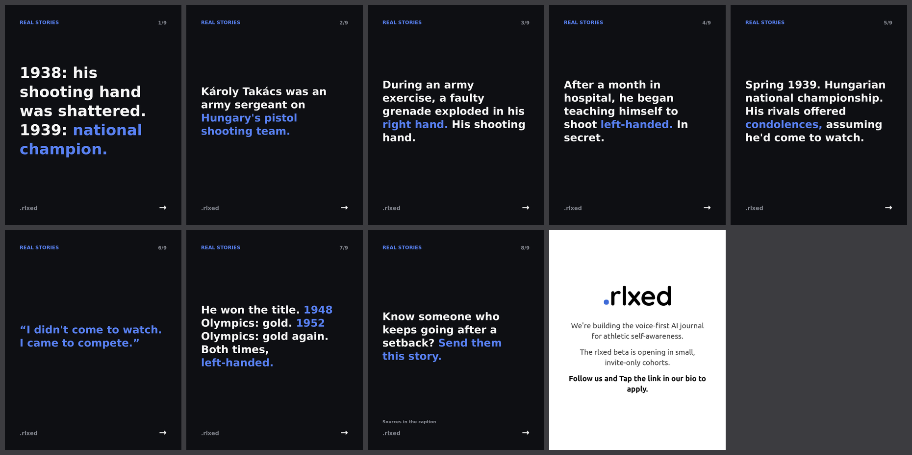

## ✅ Draft ready: Károly Takács

**Story id:** `takacs-1939`  |  **Slides:** 9  |  **Closing brand slide:** light  |  **Nothing has been posted yet.**



<details><summary>Open the slides one by one</summary>

[Slide 1](https://raw.githubusercontent.com/arvind-eshwarlal/rlxed.posts/main/content/drafts/2026-11-25-takacs-1939-run3/slide_1.jpg)  
[Slide 2](https://raw.githubusercontent.com/arvind-eshwarlal/rlxed.posts/main/content/drafts/2026-11-25-takacs-1939-run3/slide_2.jpg)  
[Slide 3](https://raw.githubusercontent.com/arvind-eshwarlal/rlxed.posts/main/content/drafts/2026-11-25-takacs-1939-run3/slide_3.jpg)  
[Slide 4](https://raw.githubusercontent.com/arvind-eshwarlal/rlxed.posts/main/content/drafts/2026-11-25-takacs-1939-run3/slide_4.jpg)  
[Slide 5](https://raw.githubusercontent.com/arvind-eshwarlal/rlxed.posts/main/content/drafts/2026-11-25-takacs-1939-run3/slide_5.jpg)  
[Slide 6](https://raw.githubusercontent.com/arvind-eshwarlal/rlxed.posts/main/content/drafts/2026-11-25-takacs-1939-run3/slide_6.jpg)  
[Slide 7](https://raw.githubusercontent.com/arvind-eshwarlal/rlxed.posts/main/content/drafts/2026-11-25-takacs-1939-run3/slide_7.jpg)  
[Slide 8](https://raw.githubusercontent.com/arvind-eshwarlal/rlxed.posts/main/content/drafts/2026-11-25-takacs-1939-run3/slide_8.jpg)  
[Slide 9](https://raw.githubusercontent.com/arvind-eshwarlal/rlxed.posts/main/content/drafts/2026-11-25-takacs-1939-run3/slide_9.jpg)  

</details>

### Read it as one story (check the flow: does every slide make sense after the ones before it?)

1. 1938: his shooting hand was shattered. 1939: national champion.
2. Károly Takács was an army sergeant on Hungary's pistol shooting team.
3. During an army exercise, a faulty grenade exploded in his right hand. His shooting hand.
4. After a month in hospital, he began teaching himself to shoot left-handed. In secret.
5. Spring 1939. Hungarian national championship. His rivals offered condolences, assuming he'd come to watch.
6. “I didn't come to watch. I came to compete.”
7. He won the title. 1948 Olympics: gold. 1952 Olympics: gold again. Both times, left-handed.
8. Know someone who keeps going after a setback? Send them this story.

### Caption (Instagram and Facebook)

```
A grenade shattered Károly Takács's shooting hand in 1938. He taught himself to shoot left-handed, won the Hungarian national title in 1939, and took Olympic gold in 1948 and 1952.

Sources: Olympics.com, Wikipedia, AP

#RealStories #KarolyTakacs #Shooting
```

### Threads text (218 of 500 characters)

```
A grenade shattered Károly Takács's shooting hand in 1938. He taught himself to shoot left-handed, won the Hungarian national title in 1939, and took Olympic gold in 1948 and 1952.

Sources: Olympics.com, Wikipedia, AP
```

### Automatic checks passed
- slide count, word counts and text fit (smallest text used: 64px)
- caption fits Threads; sources listed; nothing already published under this id

### To approve and post it
1. Open the **Actions** tab, choose **Step 2 - Approve and publish**, click **Run workflow**.
2. Type exactly: `takacs-1939`  then click the green **Run workflow** button.

To change something instead: edit the story in `content/stories.json`, then run Step 1 again. A new draft replaces this one.
